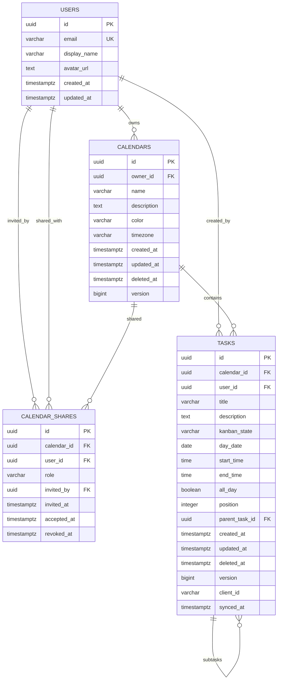

# Entity Relationship Diagram - tu-dia



## Relationship Details

### Users ↔ Calendars (1:N)
- One user owns many calendars
- Cascade delete: deleting user deletes their calendars
- `owner_id` NOT NULL, indexed

### Users ↔ Calendar_Shares (N:M via calendar_shares)
- User can be invited to many calendars
- Calendar can have many collaborators
- `role` = 'viewer' | 'editor'
- `accepted_at` NULL = pending invitation
- `revoked_at` NOT NULL = access removed
- Unique constraint on (calendar_id, user_id)

### Calendars ↔ Tasks (1:N)
- One calendar contains many tasks
- Cascade delete: deleting calendar deletes tasks
- `calendar_id` NOT NULL, indexed in composite indexes

### Users ↔ Tasks (1:N)
- User creates tasks (for attribution)
- Not the same as calendar owner - editors can create tasks
- `user_id` NOT NULL, indexed

### Tasks ↔ Tasks (1:N, self-referential)
- Subtasks support
- `parent_task_id` nullable
- ON DELETE SET NULL (orphan subtasks become top-level)

## Kanban State Machine
```
todo → in_progress → done
  ↑_______________|
```
- Any state → any state (drag-drop flexibility)
- Default: 'todo'
- Check constraint enforces valid states

## Sync Fields (Offline-First)
| Field | Purpose |
|-------|---------|
| `version` | Optimistic locking, increment on update |
| `client_id` | Client-generated UUID for deduplication |
| `synced_at` | Server timestamp of last successful sync |
| `deleted_at` | Soft delete for sync propagation |

## Access Control Rules
1. **Owner**: Full CRUD on calendar + tasks, manage shares
2. **Editor**: CRUD tasks, read calendar, cannot manage shares
3. **Viewer**: Read calendar + tasks only
4. **Public**: None (not implemented)

Enforced at application layer + RLS policies (if using PostgreSQL RLS).